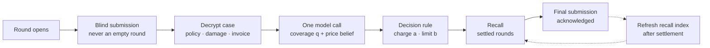

# Claim to Fame

*Team Lumenauts' bot for QuantCo's "Claim to Fame" challenge at START Hack Munich 2026.*

Every 13 minutes and 20 seconds a new insurance claim arrives: a policy, a description of the damage and a
handyman's invoice. The bot reads the claim, judges every invoice line, and answers in both roles: as the
handyman, what to charge, and as the insurer, what to accept. It plays round after round against every other
team, unattended.

---

## The challenge

Each invoice line has a hidden fair value **t**. For every line, each team submits two gross EUR totals:

- a charge **a**;
- an acceptance limit **b**, the largest charge it accepts.

|                          | accepted              | rejected            |
|--------------------------|-----------------------|---------------------|
| **fair** charge (a ≤ t)    | insurer pays a          | insurer pays 1.5 · a  |
| **inflated** charge (a > t) | insurer pays min(a, 4t) | nothing             |

To win, find t from below as the handyman, and avoid rejecting fair work as the insurer.

## How it works



### 1 · Read the case
The bot submits a safe answer the instant the round opens, before the case is even decrypted. Then it fetches
the key, decrypts the case and extracts the invoice text. A deterministic parser reads the printed line
positions, and the policy is cut down to the sections most relevant to the claim.

### 2 · Judge every line in one model call
For each line, the model returns the probability **q** that the item is covered and related to the damage, and
a price belief **p10 / median / p90** for the whole line, gross. The call runs in its own thread. If it is slow,
an identical second request goes out, and the first valid answer wins. The round's deadline always wins.

### 3 · Decide with deterministic code
The model provides evidence; code turns it into prices. The belief per line:

$$t \sim \mathrm{LogNormal}\big(\ln m,\ \sigma\big) \text{ with probability } q,\qquad t = 0 \text{ otherwise},\qquad \sigma = \frac{\ln p_{90} - \ln p_{10}}{2.563}$$

**Insurer.** Accepting x costs x, wrongly rejecting a fair x costs 1.5x, and rejecting an inflated charge costs
nothing. So accept x if and only if it is fair with probability at least two thirds:

$$b = \max\{\,x : q \cdot P(t \ge x) \ge \tfrac{2}{3}\,\},\qquad b = 0 \ \text{ if } q < \tfrac{2}{3}$$

**Handyman.** A rejected charge costs the issuer nothing, so the charge maximises the expected payment. That
point sits below the median by design:

$$a = \arg\max_a \; a \cdot P(t \ge a)$$

### 4 · Recall: learn from settled rounds
Invoice lines recur across cases, and every finished round publishes its transactions. Each transaction
brackets the fair value of its line:

- a rejected charge that still cost the insurer 1.5 · a was fair, so **t ≥ a**;
- a rejected charge that cost nothing was inflated, so **t < a**.

When a line has been seen before, the bot uses what was already proven:

- **Floor:** charge at least 0.9 × and accept at least up to 1.0 × the largest charge already proven fair.
- **Ceiling:** when most of the invoice repeats an earlier case (≥ 50 % of lines, at least 3), never charge or
  accept at or above a level that case proved inflated.

After every round, a background job pulls the settled results and rebuilds the index for the next round.

### 5 · Built to run unattended
- **Exactly one submitter:** an OS-level lock, plus a watchdog that restarts the bot if it ever stops.
- **No empty rounds:** a blind submission first, provisional values on the real line indices where needed,
  then the final answer.
- **Deadlines everywhere:** short HTTP timeouts with retries, and model calls in daemon threads.
- **Validation:** every line index is present, the numbers are finite, and p10 ≤ median ≤ p90.
- **A complete log:** one JSON record per round, and every submission checked against its acknowledgement.

## Recall in numbers

Measured on the public results for games 65–100, comparing each round's values before and after the recall step:

| | |
|---|---|
| Added by recall | **+824k EUR** |
| Rounds improved | **29 of 36** |
| Largest single line | **+95k EUR**, game 95 |

In game 95, an invoice line had a proven fair value of 8,884 EUR from an earlier round. Recall charged 7,996
EUR, which 8 of 11 teams paid; the other 3 rejected it and paid 1.5 ×.

## Quick start

```bash
pip install -r requirements.txt
cp .env.example .env        # team key + any OpenAI-compatible LLM endpoint
```

Put the encrypted case files in `Cases/`, or point `CASES_DIR` at them.

```bash
# recall data (read-only public data)
python collect_leaderboard.py && python fetch_released_cases.py && python recall.py --build

SELFTEST=1 python bot.py                      # offline self-test
ONLY_GAME=0 DRY_RUN=1 python bot.py           # test game, nothing sent
ALLOW_LIVE=1 python bot.py                    # live
powershell -ExecutionPolicy Bypass -File .\watchdog.ps1   # live, kept alive (Windows)

python -m unittest discover -s tests -v       # tests, no keys needed
```

## Project layout

| File | Role |
|---|---|
| `bot.py` | Round loop, model call with hedge, validation, decision rule, recall step, logging |
| `recall.py` | Invoice parser, fair-value brackets from the public log, floor and ceiling |
| `recall_refresh.py` | Runs after each round: refreshes public data, rebuilds the recall index |
| `collect_leaderboard.py` | Read-only snapshots of the public leaderboard |
| `fetch_released_cases.py` | Decrypts the cases of games that have already started |
| `watchdog.ps1` | Keeps exactly one live bot running |
| `tests/` | Parser, recall and bot tests |

## Credits

- The recall idea comes from [Codacabana](https://github.com/stegra05/ehl-claimscabana), winners of the August 2026 run.
- The model was DeepSeek-V4.1-Flash on AMD Token Factory; any OpenAI-compatible endpoint works.
- This repository is kept private at the organisers' request.
